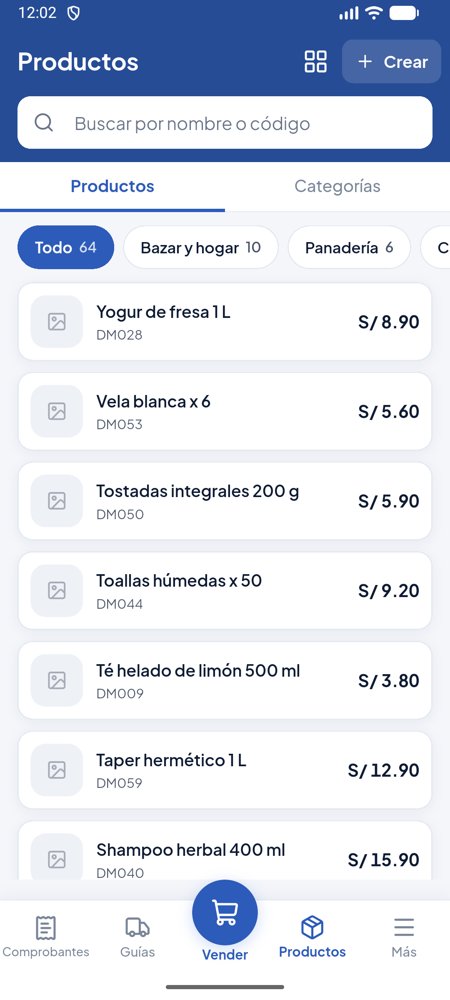
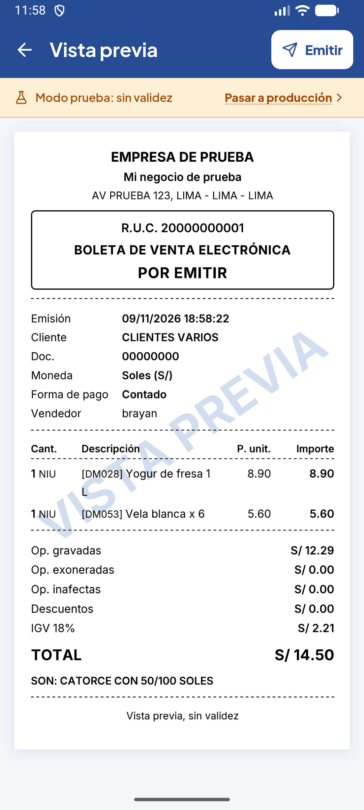
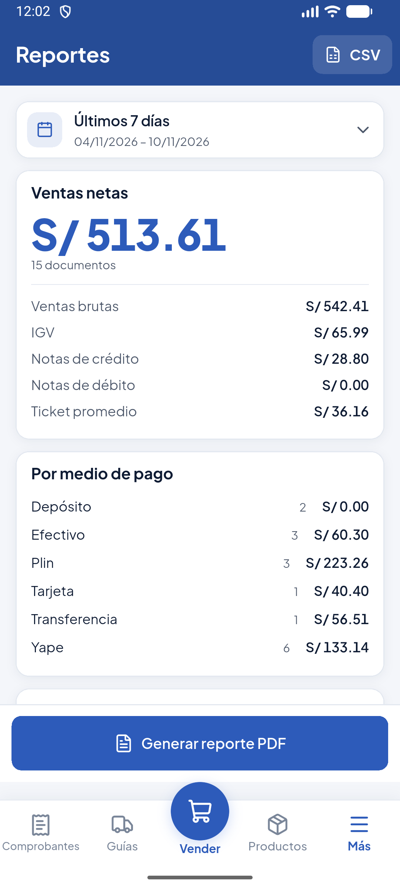

# Facturador POS

Punto de venta para Android con facturación electrónica SUNAT, pensado para una sola empresa por instalación. Emite boletas, facturas, notas de crédito y débito, notas de venta y guías de remisión, y lleva productos, clientes, stock, caja y reportes.

El proyecto se ha probado en el modo beta de SUNAT; todavía no ha emitido en producción con un certificado real.

## Capturas

| Productos | Vista previa | Reportes |
|:---:|:---:|:---:|
|  |  |  |

Son datos de ejemplo.

## Cómo está armado

```
apps/mobile/              app Flutter
services/api/             API y worker en Node con Fastify
services/sunat-gateway/   firma y envío a SUNAT, PHP con Greenter
supabase/                 base de datos, permisos, login y archivos
```

La app lee catálogos directamente de Supabase, protegidos por RLS. Lo delicado (emitir, anular, credenciales, caja) pasa por la API, que recalcula siempre los importes.

Al emitir, la API guarda el comprobante y deja un trabajo en una cola dentro de Postgres. El worker lo toma, lo manda al gateway y actualiza el estado, y la app se entera por Realtime. Así una caída de SUNAT no frena la venta.

El usuario SOL, la clave y el certificado se cargan desde la propia app y se guardan cifrados con AES-256-GCM. Solo la API puede leerlos.

## Probarlo en tu equipo

Necesitas Docker, Node 24, Flutter y Android Studio con un emulador abierto. En Windows:

```powershell
powershell -ExecutionPolicy Bypass -File scripts\levantar-local.ps1
powershell -ExecutionPolicy Bypass -File scripts\crear-usuario-demo.ps1
```

El primero levanta Supabase, la API, el worker y el gateway, y genera `services/api/.env` y `apps/mobile/env.json` si no existen. El segundo crea el usuario:

| Correo | Contraseña |
|---|---|
| `demo@gmail.com` | `demo12345` |

Esa cuenta es solo para tu entorno local. Después abre la app:

```powershell
cd apps\mobile
flutter pub get
flutter run --dart-define-from-file=env.json
```

También puedes abrir `apps/mobile` en Android Studio y usar la configuración **Facturador POS**.

Al entrar, pulsa **Omitir y probar la app** y ya puedes vender. Los datos reales de la empresa se piden recién al pasar a producción.

Si quieres llenarla con unos 300 comprobantes de ejemplo (solo beta):

```powershell
powershell -ExecutionPolicy Bypass -File scripts\cargar-datos-demo.ps1
```

No lo hagas en una base que vaya a producción: adelanta la numeración de las series.

## Probar la API en Postman

Importa [`docs/postman/facturador.postman_collection.json`](docs/postman/facturador.postman_collection.json). Luego, en las variables de la colección, pega la clave `ANON_KEY` que muestra este comando:

```powershell
npx supabase status
```

Ejecuta las peticiones en orden. La primera inicia sesión y guarda el token para las demás; la de emitir manda una boleta real a SUNAT beta.

También puedes correrla por consola:

```powershell
npx newman run docs/postman/facturador.postman_collection.json --global-var anon_key=TU_ANON_KEY
```

Las rutas principales son estas:

| Método | Ruta | Para qué |
|---|---|---|
| `POST` | `/comprobantes/previsualizar` | Calcula los totales sin guardar |
| `POST` | `/comprobantes/vista-previa` | Devuelve el PDF antes de emitir |
| `POST` | `/comprobantes` | Emite. Exige la cabecera `Idempotency-Key` |
| `GET` | `/comprobantes/:id` | Datos y estado SUNAT |
| `GET` | `/comprobantes/:id/archivo/:tipo` | Enlace a PDF, XML o CDR |
| `POST` | `/comprobantes/:id/anular` | Anula por resumen, baja o según corresponda |
| `POST` | `/sunat/probar` | Prueba la conexión con SUNAT |
| `PUT` | `/sunat/entorno` | Cambia entre beta y producción |

Con la misma `Idempotency-Key` y el mismo cuerpo, la API devuelve el comprobante original en lugar de emitir otro. Eso permite reintentar sin duplicar ventas.

## Pasar a producción

Desde **Ajustes → SUNAT → Pasar a producción**, la app te pide en orden los datos reales de la empresa, el usuario y la clave SOL y el certificado, y al final que escribas el RUC para confirmar. La guía para el trámite con SUNAT está en [docs/SUNAT.md](docs/SUNAT.md) y la de servidores en [docs/DESPLIEGUE.md](docs/DESPLIEGUE.md).

Para distribuir la app, antes hay que configurar tu propia firma de Android: ahora el modo release usa la clave de debug.

## Pruebas

```bash
cd services/api && npm run typecheck && npm test
cd apps/mobile && flutter analyze && flutter test
node scripts/escanear-secretos.mjs
```

El escáner falla si un commit incluiría claves, certificados o archivos `.env`. Para que corra antes de cada commit:

```bash
git config core.hooksPath scripts/hooks
```

## Lo que falta

- Probar la emisión en producción con un certificado real.
- Enviar guías de remisión reales a SUNAT: necesitan claves GRE, que aún no he usado.
- Confirmar la aceptación de anulaciones por resumen en beta, cuya consulta de ticket falló por tiempo de espera en mis pruebas.

## Licencia

MIT
